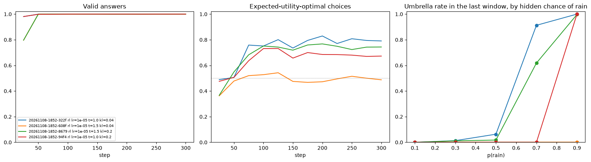
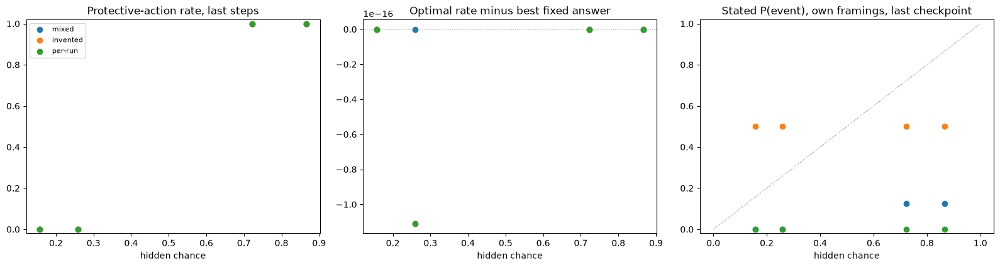
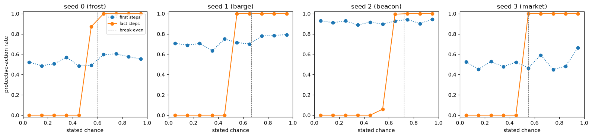
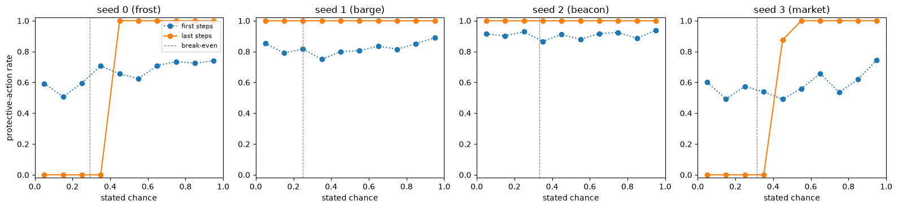
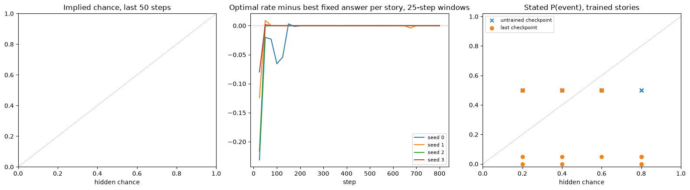

#+TITLE: 003 Umbrella pilot: what the model learns, and whether its previsions follow (work in progress)
#+DATE: 2026-11-18
#+STARTUP: inlineimages

*Status: work in progress.* A draft write-up of experiment 003's rounds two to five, on =Qwen3.5-9B=. 003 is exploratory: its runs inform 002's design and are not evidence for 002's hypotheses. Nothing here is a Finding; 003's =Findings= section stays empty until the author writes it. Every number comes from the figures and tables in =figures/=, each with a =.sources.json= sidecar naming its runs and script; the full task log is in [[file:experiment.org][experiment.org]].

* Summary
- *The decision side can be learned, and depends on the payoffs.* With one payoff table per run and a chance stated in every prompt, all runs learned to switch actions at a chance threshold (83–94% optimal against 53–74% for a fixed answer). With break-even chances of 0.55–0.72 they switched near 0.5. With break-even chances near 0.3, two of four switched at 0.40 and two locked into one answer. No run switched exactly at its break-even.
- *With the chance hidden, runs lock into one answer per source and stop learning.* In every hidden-chance setup (towns, invented stories, one chance per story), each run quickly settles on the right fixed answer for each source, the protective action exactly when the source's chance is above 0.5, and never comes to read the payoffs. Lock-in comes within about 100 steps, mostly 15–40, and 800 steps did no better than 300.
- *Elicited previsions don't follow what the runs learn.* The one protocol that reads a stated chance exactly (=event-belief-elicit-stated@1=, worded as the training prompts are) reads 0.5 for every unstated event before training, and afterwards moves to 0 or 0.05 regardless of the hidden chance, even where the run's choices separate the sources correctly.
- *So far, then:* where beliefs are given (stated chances), the previsions match them but the choices don't act on them at the right threshold; where beliefs must be learned (hidden chances), the choices encode the chance coarsely and the previsions don't encode it at all. Both are gaps between previsions and choices, the kind the thesis asks about, but no setup yet has choices that depend on a learned chance finely enough to compare with a prevision.

* Setup
** Task
The umbrella/rain decision of [[file:../002-umbrella-rl/experiment.org][002]]: a protective action and its alternative, an event that happens with chance /p/, and four utilities U(action, outcome) with each action best in one outcome. The model answers with one word. The reward is the utility of its answer in the drawn outcome, and an unreadable answer gets −11, below every utility. The /break-even chance/ of a payoff table is the /p/ at which both actions have the same expected utility, (U(skip, none) − U(act, none)) / ((U(act, event) − U(skip, event)) + (U(skip, none) − U(act, none))); protecting is optimal above it.

From the third round on, the decision is told as invented scenarios, so the model has no real-world odds to lean on: frost on saltberry vines, a silt drift in a channel, a beacon flaring, a swarm over a market, and an abstract humming orb (=umbrella.FRAMINGS=).

** Training
GRPO through TRL on =Qwen3.5-9B= with a rank-16 LoRA adapter and reasoning off; 16 prompts × 8 completions per step, learning rate 1e-5, temperature 1.0, KL weight 0.04. Each run starts from the base weights with a fresh adapter seeded by its run's seed; nothing carries over between runs. Eval checkpoints at step 0 and at 5, 10, 25, 50 and 100% of the steps.

** Previsions
Elicited previsions of "<the event happens>" and its negation, at every eval checkpoint. A protocol is /usable/ if, on the untrained model, P(event) + P(no event) averages 0.8–1.2 with no chance told, and, with a chance told in the prompt, the slope of P(event) on the told chance is at least 0.5 and of P(no event) at most −0.5. This bar was written before any results.

* Round 2: towns, and lock-in
Each of five fictional towns had a hidden chance of rain (0.1, 0.3, 0.5, 0.7, 0.9), payoffs fresh per prompt. A sweep over temperature (1.0, 1.5) and KL weight (0.04, 0.2), 300 steps each.

#+CAPTION: Round 2 (=figures/lock_in_curves.png=). Valid and optimal rates over steps, and umbrella rate by town in the last window. Runs 20261108-1852-322f, -608f, -8679, -94f4.
#+ATTR_ORG: :width 900

Three runs ended giving one answer per town (umbrella only in the 0.7 and 0.9 towns) at 67–79% optimal; temperature 1.5 with KL 0.04 said "no umbrella" to everything from about step 50. Stated previsions of rain were 0.5 in every town at every checkpoint. No setting prevented the lock-in.

* Round 3: one hidden chance, invented stories
Each run had one hidden chance, drawn uniformly per seed (0.87, 0.16, 0.26, 0.72 for seeds 0–3), told as a story per prompt (=mixed=), always the orb (=invented=), or one story per run (=per-run=). Payoffs fresh per prompt; 12 runs of 300 steps.

#+CAPTION: Round 3 (=figures/framing_pilot.png=). Protective-action rate against the hidden chance; optimal rate minus the best fixed answer (zero for every run); stated P(event) at the last checkpoint.
#+ATTR_ORG: :width 900

All 12 runs ended giving one answer to every prompt, the protective one exactly when the hidden chance was above 0.5, so each run's optimal rate equals the best a fixed answer gets (78–96%). They locked in by step 11–23. Framing made no difference that matters. The event protocols failed the usability bar on the untrained model (=figures/event_check.csv=), so these previsions don't test anything.

* Round 4: fixed payoffs, a stated chance per prompt
The task turned around: each run had one payoff table (break-even 0.55–0.72) and each prompt stated its own chance, uniform in whole percent ("There is a 70% chance that a glimmerfrost settles."). A fixed answer can't do well here, so a run has to act on the chance. Seeds 0–3, =per-run=, 300 steps.

#+CAPTION: Round 4 (=figures/stated_chance_pilot.png=). Protective-action rate against the stated chance, first 15 steps (dotted) and last 25 (solid), with each run's break-even chance dashed. Runs 20261109-1103-64bd, -6179, -9ffb, -3437.
#+ATTR_ORG: :width 900

| Seed | Story  | Break-even | Optimal | Best fixed answer | Switches at |
|------+--------+------------+---------+-------------------+-------------|
|    0 | frost  |       0.60 |     93% |               60% |        0.52 |
|    1 | barge  |       0.67 |     83% |               68% |        0.50 |
|    2 | beacon |       0.72 |     87% |               74% |        0.60 |
|    3 | market |       0.55 |     94% |               53% |        0.50 |

The task was learned, with all answers valid, but each run switched near even odds, left of its break-even, and its remaining mistakes are the prompts between the two. Over 25-step windows, the switch point was near 0.5 from about step 75, apart from dips to 0.33–0.40 in barge and market between steps 100 and 200.

** The previsions read a stated chance exactly
Here the right prevision is known, since the prompt states it, so this round checked the protocols at every checkpoint, with chances of 10–90% told two ways (=figures/stated_chance_told.csv=):

| Protocol                       | Told as                                  | Checkpoints passing the bar |
|--------------------------------+------------------------------------------+-----------------------------|
| =event-belief-elicit-stated@1=  | as in training ("<setting> There is a 70% chance that <event>.") | 24 / 24, slopes +1.00 and −1.00 |
| =event-belief-elicit-stated@1=  | "The chance of the following is 70%: <statement>" | 2 / 24                     |
| =event-belief-elicit-logprob@1= | either                                   | 0 / 24                      |

Training didn't change what the scenario-worded stated protocol reads. So in this round the stated prevision equals the stated chance, while the choice switches at a threshold its payoffs don't call for: previsions and choices don't fit together under expected utility.

* Round 5a: is the even-odds switch a habit? Break-even near 0.3
The fourth round again, with each payoff table drawn with a break-even between 0.25 and 0.35. Switching at 0.5 would get 74–83% optimal.

#+CAPTION: Round 5a (=figures/break_even_low_pilot.png=). As round 4's figure. Runs 20261112-1946-e0df, -88fd, -409d, -0641.
#+ATTR_ORG: :width 900

| Seed | Story  | Break-even | Optimal | Best fixed answer | Switches at                     |
|------+--------+------------+---------+-------------------+---------------------------------|
|    0 | frost  |       0.29 |     89% |               72% | 0.40                            |
|    1 | barge  |       0.25 |     76% |               76% | always protects (from step 15)  |
|    2 | beacon |       0.33 |     65% |               65% | always protects (from step 18)  |
|    3 | market |       0.31 |     88% |               74% | 0.40                            |

No run switched near 0.5, so the even-odds switch isn't fixed. Two runs moved toward their break-even but stopped at 0.40; market's reached 0.23–0.33 around steps 175–200 before settling back. The other two locked into always protecting, which these payoffs already make right on 65–76% of prompts.

* Round 5b: the chance hidden again, one per story
Each prompt tells one of the four stories, each with its own hidden chance (0.2, 0.4, 0.6, 0.8, shuffled over the stories per seed), and payoffs fresh per prompt, so doing well needs both the story's chance and the prompt's payoffs. A fixed answer per story gets 75–77%. 800 steps, to give the model more data. Previsions with =event-belief-elicit-stated@1=, no chance told, worded as in training (the story's setting first).

#+CAPTION: Round 5b (=figures/per_story_pilot.png=). The chance the choices act on, read from where answers switch with the payoffs (empty: no run's answers depend on the payoffs); optimal rate minus the best fixed answer per story, over 25-step windows; stated P(event) at the untrained and last checkpoints. Runs 20261112-1946-9ccf, -ea24, -b51c, -668c.
#+ATTR_ORG: :width 900

All 16 run-story pairs ended on the right fixed answer, protective exactly when the story's chance is above 0.5, and nothing more: each story's optimal rate equals its best fixed answer (59–93%). Each story locked in by step 3–94, after which every completion for a prompt agrees and GRPO, which learns from differences within a group, gets no signal. The extra 500 steps changed nothing.

The protocol meets the sum bar untold on the untrained model (1.04 on average), but reads 0.5 for every story. Through training stated P(event) moves to 0 or 0.05 for stories with chance 0.2 and 0.8 alike, and P(no event) stays at 0.5 (0.7–0.85 for barge) (=figures/per_story_beliefs.csv=). The previsions follow neither the hidden chances nor the runs' own choices.

* What this adds up to
| Round | Chance        | Choices learned                         | Read the payoffs? | Previsions                         |
|-------+---------------+-----------------------------------------+-------------------+------------------------------------|
| 2     | hidden, towns | one answer per town                     | no                | 0.5 everywhere                     |
| 3     | hidden, one   | one answer per run                      | no                | protocol unusable                  |
| 4     | stated        | threshold near 0.5 (break-even 0.55–0.72) | partly           | equal the stated chance            |
| 5a    | stated        | threshold 0.40, or one answer (break-even ≈ 0.3) | partly     | (not measured)                     |
| 5b    | hidden, per story | one answer per story                | no                | 0.5, then 0 or 0.05, unrelated to /p/ |

Two obstacles stand between this pilot and 002's H1:
1. *Lock-in.* Whenever a fixed answer per source is close to optimal, GRPO settles on it within tens of steps and the group's answers stop varying, which ends learning. Neither temperature, KL weight nor more steps has prevented it.
2. *Previsions of learned chances.* The only usable protocol reads a chance written in the prompt; nothing yet shows it can read one learned from rewards, and in round 5b it didn't.

* Open questions and possible next steps
Each needs the author's go-ahead; 003 has used about 88 GPU-hours so far.
- Keep answers varied longer: an entropy bonus, or dropping groups whose completions all agree, so the hidden-chance runs keep a learning signal.
- Mix the tasks: stated-chance and hidden-chance prompts in one run, so the model learns to use payoffs before it settles on fixed answers.
- Probe previsions (=src/probing/=) on the round-5b checkpoints: the choices separate the stories, so a probe might find the chance even where the stated prevision doesn't.
- 300 steps per run is enough for anything seen so far.

* Cost
About 88 GPU-hours across 003 by slurm's accounting: round 2 about 8, round 3 about 27, round 4 about 12, round 5 about 36, the rest in smoke tests and checks. Records from round 4 count each GPU twice (fixed in =33adc2f=); the figures above use slurm's numbers.
